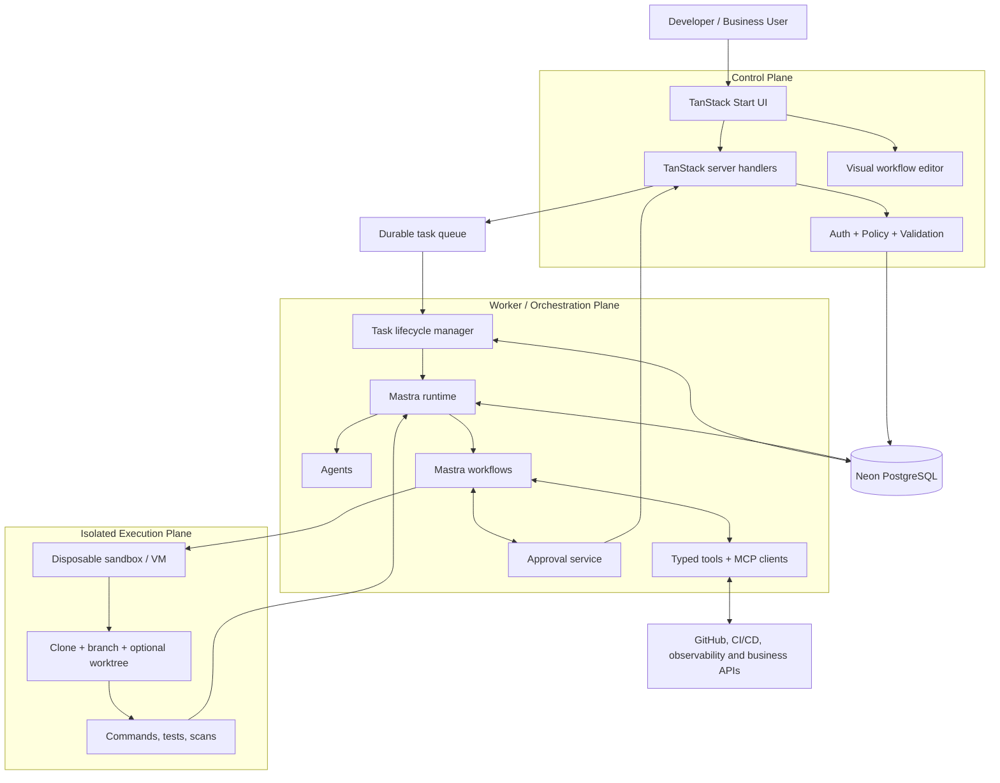

# Architecture

## 1. Purpose and design principles

The platform coordinates software-delivery tasks across repositories and existing business services. It is a control plane plus a separately operated execution plane, not a coding chatbot with unrestricted access to a server.

Principles:
- Keep the browser, control plane, orchestration worker, and untrusted code execution separate.
- Use Mastra for agent/tool/workflow composition; use deterministic application code for authorization and policy.
- Keep provider-specific model behavior behind adapters/configuration.
- Store workflow definitions as versioned, validated JSON, independent of Mastra implementation details.
- Use Neon PostgreSQL as the primary application database and system of record.
- Make runs observable, recoverable, bounded, and auditable.
- Require human approval for high-impact actions.
- Design for parallel task execution, but serialize operations that mutate the same Git branch or shared resource.

## 2. High-level diagram



## 3. Runtime responsibilities

### Web application
Use Bun and TanStack Start with React, TanStack Router, and TanStack Query. The browser renders project/repository setup, workflow authoring, task submission, run timelines, logs, diff summaries, approvals, and integration configuration.

TanStack server handlers/functions are the control-plane boundary. They validate requests, authenticate the caller, enforce tenant access, persist task metadata, and enqueue work. They must not run arbitrary repository code or hold open an HTTP request for the full agent execution.

Implemented in wave 3 (`apps/web`): TanStack Start + Router + Query with two routes — task submission and runs/tasks list. Server functions use `createServerFn` with `@isolate/shared` validation and `Cache-Control: private, no-store`; DB access is server-only (`@isolate/db` in Postgres mode, `@isolate/db/testing` fakes in local mode when `DATABASE_URL` is absent). A production build plus a client-bundle secret sweep (`scripts/check-client.ts`, 26 checks) run in CI to keep provider keys and DB URLs out of the browser.

Authentication (wave 5): the web app uses **Neon Managed Better Auth** (`@neondatabase/auth`) as its identity provider. The browser never contacts the auth host. A server-only route (`routes/api.auth.$.tsx`) proxies `/api/auth/*` upstream and rewrites the session cookies onto this origin (`__Secure-neon-auth.*`), so the Better Auth SDK and the cookie secret stay server-side and no third-party cookie is involved. The route file declares only `server.handlers`, which prunes it from the client route tree, and server functions are compiled to RPC stubs — the client-bundle sweep asserts that `@neondatabase/auth`, `better-auth`, `neonauth` and `__Secure-neon-auth` never appear in the browser build.

Google sign-in (wave 6): `startGoogleSignIn` runs server-side, builds a same-origin `callbackURL` from the request origin, and asks the SDK for a provider URL with `disableRedirect: true`. The browser navigates to Google; Neon returns to `/auth/callback` with a session verifier and the first-party challenge cookie; that server route runs `processAuthMiddleware` to exchange the verifier for session cookies and relays the raw `Set-Cookie` values. The returned provider URL must be public https. The app origin must be registered in Neon's trusted-domain list (`http://localhost:3000` for development; the deployment origin before hosting). The shared Google provider needs no local credentials; production should use its own Google client with `{NEON_AUTH_BASE_URL}/callback/google` as the redirect URI.

### Worker
Run a separate TypeScript process. It claims jobs, applies idempotency, starts and monitors executions, invokes Mastra workflows, persists status/events, handles cancellation/timeouts, and cleans up sandboxes. Use a durable queue or a database-backed queue with atomic claiming, retries, dead-letter handling, and duplicate protection. Select the concrete queue implementation in an ADR before relying on it.

Composition (wave 6): `apps/worker/src/runtime-composition.ts` binds the Postgres queue (`PostgresQueueRepository`), the `UsageSink` over `usage_records`, and the DB-backed `loadTaskContext`. Provider selection is explicit and fail-closed: `SANDBOX_PROVIDER=modal` requires both Modal tokens and builds the lazy Modal client; `INFERENCE_PROVIDER=baseten` requires the Baseten key and builds the Mastra runtime factory. With no database the loop stays on the unavailable queue; with no provider flags the offline `NullProvider`/unconfigured runtime remain the defaults.

Execution lifecycle (wave 7): the handler writes durable state through an injected `ExecutionLifecycle` (`@isolate/shared`). One job records one `task_attempts` row, transitions `queued → planning → executing → validating → review_ready` (or `awaiting_approval`), and appends `run_events` for clone, agent turns, validation and artifact creation. The lifecycle implementation in `@isolate/db` keeps every read/write tenant-scoped and reuses the task state machine; the worker never issues raw SQL. A sensitive action persists an approval bound to the payload SHA, moves the task to `awaiting_approval`, suspends the run and acks the job; a separate `resume_task` job continues only for an approved record with the same SHA. `isCancelled` is checked before every turn and before push, and teardown remains exactly-once.

Worker wiring (wave 7): `runtime-composition.ts` binds `PostgresExecutionLifecycle`, `createTaskWorkspaceGit` (only with a real sandbox provider) and, when `GITHUB_APP_*` is complete, the installation-token broker plus `resolveSandboxEnv` (create-time `GIT_CONFIG_*` credential). `pushEnabled` is true only with a real sandbox **and** a broker, and can be opted out with `GITHUB_PUSH_ENABLED=false`. A partial GitHub configuration fails closed with `MISSING_CONFIG`; no token is logged. The queue vocabulary gained `resume_task` in the same change as the `jobs_type_check` migration.

### Mastra agents and workflows
- **Agents** reason within a defined role and receive only the tools they need.
- **Workflows** define the SDLC state machine, branching, retries, persisted state, and approval boundaries.
- **Tools** are typed, validated operations. A tool is not authorized merely because an agent can call it.
- **Memory/RAG** is optional and must be introduced only for a clear retrieval use case. Keep per-tenant data boundaries and source citations; do not place secrets in memory.
- **Evaluations** cover task success, tool correctness, policy compliance, regression behavior, and cost/latency.

Begin with one coding agent and one explicit workflow. Add planner/reviewer agents only where tests show a useful improvement.

Provider plan (wave 4, updated): inference has two mutually exclusive configurations selected by `INFERENCE_PROVIDER`:
- `meta` — **local/dev and pre-production agent tests** on Meta Model API (`https://api.meta.ai/v1`), model `muse-spark-1.3-contributor` only. No other Meta model is accepted.
- `baseten` — **production** on Baseten Model APIs (`https://inference.baseten.co/v1`, `BASETEN_API_KEY`, `meta-models/muse-spark-open-1026`).

Both use Mastra's existing OpenAI-compatible model object; `@mastra/core` stays pinned and tool calls are Mastra-native. Meta Muse models are the only inference models configured; no fallback provider or model exists. Usage is recorded per call in `usage_records` and bounded by per-task token/step/time caps. No provider SDK is imported by the web app or the browser bundle.

Per-job tool binding (wave 6): the worker provisions the sandbox first, builds a `SandboxToolBackend` over that handle (every call passes `executeCommand` with the trusted `CommandPolicy`), and passes it plus the job's organization/task ids to `CodingAgentRuntimeFactoryOptions`. The factory wires `wireSandboxTools(...).forTask(...)`, so one agent turn can reach exactly one sandbox and one task. Without a backend the runtime runs tool-less.

### Sandbox
Run all untrusted repository commands in a disposable cloud sandbox or VM. The sandbox receives only scoped, short-lived credentials required for its task. Enforce execution timeout, CPU/memory limits, output limits, network egress policy, and cleanup. The worker host and web server must never execute untrusted project scripts.

A Git worktree is a workspace convenience, not a security boundary. For independent parallel tasks, use separate sandboxes and branches/worktrees. Never allow concurrent writers to mutate the same checkout or branch without an explicit coordination protocol.

Execution provider (wave 4): `packages/sandbox` defines a deny-by-default `SandboxProvider` (`create/execute/destroy`) with `NullProvider` as the default. `ModalSandboxProvider` (`modal@0.11.x`) provisions one disposable Modal sandbox per task with explicit CPU/memory/lifetime/idle limits, network denied unless an allowlist is required, argv-only execution, bounded output, and idempotent teardown in every exit path. Command policy (timeout, arg shape, output cap, egress intent) stays in trusted platform code and is applied before the provider is called; the provider never falls back to a local process. Live Modal tests are opt-in and intentionally tiny.

Boot safety (wave 6): `createModalSandboxClient` resolves the Modal app lazily on the first `create` (memoized), so constructing the provider at worker boot performs no network I/O. The worker's default workspace policy allows `cat`, `ls`, `grep`, a small set of read-only `git` shapes and `bun test`/`bun run test|typecheck|lint`; any other argv is `POLICY_DENIED` before the provider runs.

Task workspace (wave 7): `TaskWorkspaceGit` (`packages/sandbox/src/git/workspace.ts`) is the only path from a sandbox to repository content. It preflights the image (`git`, `bun`, `grep`), shallow-clones one branch of a credential-free https URL into an empty workspace, creates the task branch from the base, commits, and produces a bounded `--stat`/patch. The Git credential is create-time `SandboxSpec.env` consumed through `GIT_CONFIG_*` `http.extraheader`; it never appears in argv, URLs, `git remote -v`, logs, errors or fixtures. Clone and push command shapes request an egress allowlist of `github.com` + `codeload.github.com`; every other command stays `deny`. A missing toolchain binary fails closed as `SANDBOX_IMAGE_UNSUPPORTED` before any network use. The default Modal image is `oven/bun:1` (git + Bun); the preflight, not the image name, is the guarantee.

Review close (wave 8): the execution handler now runs the repository's `validation_command` inside the same sandbox after the diff gate and **before** any push. The command is operator-authored and executed argv-only with no shell, egress denied, a bounded timeout (1000–900000 ms) and a bounded log; an invalid command is refused before execution. `passed` continues the flow, `failed` transitions `validating → failed`, stores the report and log artifact, and never pushes — there is no automatic repair. A task whose repository has no command records `skipped` and keeps the wave-7 meaning of `review_ready`. After a successful push the worker reads the pushed HEAD and requests a **second** approval (`github.create_pull_request`) bound to `{repositoryFullName, headBranch, baseBranch, headSha}`, moves the task to `awaiting_approval` and acks. A `create_pull_request` job re-verifies the approval status, payload SHA and target, calls the connector (which re-checks the remote head SHA and is idempotent for an already-open PR), persists `pull_request_number`/`pull_request_url` and moves `awaiting_approval → pull_request_created`. The control plane exposes two server-side actions with no UI yet: `retryTask` creates a new task in the same boundary when the source is `failed` (same repository, goal, acceptance criteria, ownership and budget; `retry_of` linked, depth bounded to 3) and enqueues one `run_task`; `decideApproval` records the human decision with an audit row and enqueues `resume_task` (push) or `create_pull_request` (PR), or fails the task on rejection. Both check the membership capability before touching storage. The review surface columns and the `create_pull_request` job type arrived in migration `0006`.

## 4. Suggested folder conventions

Adjust these to the generated TanStack Start scaffold, but keep ownership boundaries stable.

```text
apps/
  web/
    src/routes/                  # TanStack file-based routes
    src/components/              # UI components
    src/features/                # Product feature modules
    src/server/                  # Server-only handlers and services
  worker/
    src/                          # Queue consumer and run lifecycle
packages/
  mastra/
    src/mastra.ts                 # Mastra instance and registration
    src/agents/                   # Agent definitions and instructions
    src/tools/                    # Typed tools and tool factories
    src/workflows/                # Versioned SDLC workflows
    src/evals/                    # Evaluations and regression datasets
  workflow-schema/
    src/nodes/                    # Node schemas and definitions
    src/validate.ts               # Graph validation
    src/compiler/                 # Workflow definition -> runtime plan
  sandbox/
    src/providers/                # Sandbox provider adapters
    src/git/                      # Clone, branch, worktree operations
    src/policy/                   # Command and resource policy
  integrations/
    src/github/
    src/mcp/
    src/business/
  db/
    src/client.ts                 # Neon connection/client
    src/schema/
    src/repositories/
    migrations/
  shared/
    src/types/
    src/errors/
    src/logging/
docs/
project/
```

Keep provider credentials, database clients, MCP clients, sandbox SDKs, and Mastra runtime imports in server-only packages. Never import them from browser bundles. Add build-time checks or lint rules to prevent accidental client-side imports.

## 5. Core data model

Use Neon PostgreSQL for durable application state. At minimum, model:
- `organizations`, `users`, `memberships`
- `repositories`, `integrations`, `integration_permissions`
- `workflow_definitions`, `workflow_versions`
- `compiled_plans`, `rejection_issues` (wave 3 — see §6)
- `tasks`, `task_attempts`, `workflow_runs`
- `run_events`, `artifacts`, `approvals`
- `tool_invocations`, `audit_events`, `usage_records`

Every tenant-owned record must carry an organization/tenant identifier and be checked in server-side authorization. Use foreign keys, unique idempotency keys, and explicit lifecycle enums. Keep large logs/artifacts in object storage when appropriate; store metadata and references in Neon.

Use Neon connection pooling appropriately for serverless/web workloads, and ensure migrations and transaction patterns work with the chosen driver. Do not assume every adapter supports every pooling mode. Select the Mastra storage adapter only after confirming current PostgreSQL/Neon support; do not introduce another database merely to satisfy a tutorial.

Implemented data-plane notes (wave 3):
- Neon Pg 17, PgBouncer transaction mode → `prepare: false`; row mappers normalize jsonb via `parseJsonbColumn` (drivers may return jsonb as a raw JSON string on pooled endpoints).
- JSON writes bind `$n::text::jsonb`, never `$n::jsonb`: postgres.js stringifies a JS string parameter before the cast, which would store a JSON *string scalar* (`jsonb_typeof = 'string'`). This was latent under `0001` and became a hard failure once `0002` added `jsonb_typeof` CHECKs (W4-B tracks the remaining `0001` write paths).
- Compilation artifacts are insert-only and tenant/version-scoped; composite foreign keys `(organization_id, workflow_definition_id)` and `(workflow_definition_id, workflow_version)` prevent cross-tenant and nonexistent-version references.

Identity and tenancy (wave 5):
- Credentials, sessions, and OAuth live in the Neon-managed `neon_auth` schema (`user`, `session`, `account`, `verification`, `organization`, `member`, `invitation`, `jwks`, `project_config`). That schema is owned by Neon, not by this repository: never migrate or write to it directly.
- **The id is the identity bridge.** Neon Auth issues `uuid` user ids and `public.users.id` is a `uuid`, so the authenticated user id *is* the platform user id. `memberships.user_id`, `tasks.created_by` and `workflow_versions.created_by` keep pointing at the same person the session belongs to. No second mapping table exists.
- `public.organizations` + `public.memberships` remain the source of truth for tenancy. Better Auth's organization plugin is **not** used for tenancy: Neon runs it server-side for its own UI, and it cannot express the platform's `viewer` role.
- `memberships` PK is `(organization_id, user_id)`, which cannot serve the reverse "which organizations may this caller see?" lookup. `0003_auth_identity.sql` adds `memberships_user_id_idx (user_id)`.
- Tenancy is enforced in application code via `organization_id = $1` on every read and write; **there is no row-level security**. Isolation is therefore a property of the service layer, and every repository query must keep the organization predicate.
- There is deliberately **no cross-schema foreign key** from `public.users.id` to `neon_auth.user.id`: the auth schema is Neon-managed and may be re-created independently. The shared UUID plus `users.email UNIQUE` enforce the same invariant without coupling migrations to Neon's lifecycle.

Task execution context (wave 6, `0004_task_context.sql`):
- `tasks.goal` (text), `tasks.acceptance_criteria` (jsonb array) and `tasks.file_ownership` (jsonb array) are the authored "what to do / what done means / what may change" inputs. Existing rows default to `''`/`[]`.
- `PostgresTaskContextRepository` joins `tasks` to `repositories` under one `organization_id` and returns a neutral row; the worker maps it to `TaskContext` and fails closed on missing, terminal or foreign tasks. The compiled plan remains the immutable "how", not the task intent.

Execution artifacts (wave 7, `0005_execution_truth.sql`):
- `artifacts.content` (nullable text, ≤256 KiB byte CHECK) stores a bounded inline diff for review; `storage_ref` is `inline:<sha256>` until object storage exists. Oversized patches are truncated with an explicit flag, and the sha covers the stored bytes.
- `0005` also adds `repositories (organization_id, external_full_name)` uniqueness, `task_attempts (task_id, attempt_index)` uniqueness, a partial unique index on pending `approvals (task_id, action)`, and an organization-scoped task list index. All are additive and idempotent.

## 6. Workflow definition and compilation

The visual editor stores a versioned JSON graph:
- nodes have stable IDs, typed configuration, and declared input/output schemas;
- edges define data flow and control flow;
- graph validation rejects missing nodes, cycles where unsupported, invalid types, unauthorized tools, unreachable required steps, and unsafe configuration;
- the compiler maps the supported subset to Mastra workflow steps and tool calls;
- each run pins a workflow version so later edits cannot silently change an active execution.

Never evaluate arbitrary user expressions with `eval` or compile arbitrary user-provided TypeScript in the control plane. Start with a small, explicit condition language and a finite node registry.

Compilation persistence (wave 3, `0002_workflow_compilation.sql`):
- `compiled_plans` — one immutable plan per `(organization_id, workflow_definition_id, workflow_version)`. Insert-only: a second save of an existing pin is `CONFLICT` (even for an identical plan); callers must create a new version. A plan/pin CHECK enforces `plan->>'workflowId' = definition` and `plan->'versionPinned' = version`.
- `rejection_issues` — append-only history of compiler rejections for a version (non-empty issues array CHECK; indexed by `(org, def, version, created_at DESC, id DESC)`), not a mutable "last error".
- Repositories expose pure decision helpers (`evaluateWorkflowVersion`, `evaluatePlanSaveOutcome`) shared by the Postgres drivers and in-memory fakes, so `NOT_FOUND` (foreign tenant / missing version) is never misreported as `CONFLICT`.

Node-id grammar: ids must not contain `.`. Mastra resolves suspended steps by splitting the resume label on `.`, so a dotted id (e.g. `sdlc.review_ready`) is parsed as a nested path and cannot be resumed. The compiler rejects dotted ids with `INVALID_NODE_ID` at `nodes[index].id` and never rewrites authored ids. `compileWorkflow`/`validateDefinition` accept `unknown` from authored JSON and reject unknown fields rather than stripping them; diagnostics report paths and codes without echoing authored values.

## 7. Integrations, MCP, and custom skills

Prefer native connectors for critical operations such as GitHub permissions, PR creation, and approvals. Use MCP for interoperable tools where it provides value. Treat MCP server metadata, descriptions, responses, and resources as untrusted data. Register servers through an admin-controlled allowlist, validate tool schemas, apply per-tool permissions, and record every invocation.

A skill is reusable instruction/procedure content; it is not itself a security boundary. A custom business action should be a typed tool with a schema, implementation, permission policy, tests, and audit logging. Do not permit arbitrary remote MCP servers or custom executable code by default.

## 8. Approval and policy flow

1. Agent proposes a tool operation.
2. Trusted policy code validates user/tenant access, action risk, arguments, scope, and credentials.
3. Low-risk allowed actions proceed and are audited.
4. Sensitive actions create a persisted approval record and pause the workflow.
5. An authorized user approves or rejects through a server handler.
6. The worker resumes from durable state and revalidates the action before execution.

Wave 7 queue mechanics: when push is enabled the approval is requested during `planning`, before a sandbox exists, and is bound to the exact `{repoUrl, branch}` payload SHA. The pausing job is acked as complete, the task sits in `awaiting_approval` with no lease and no sandbox, and the approval decision enqueues a `resume_task` job. Resume is admitted only when the approval is `approved`, unexpired, and its stored `payload_sha256` equals the SHA of the action the worker is about to take; a mismatch is `CONFLICT`, a rejection/expiry moves the task to `failed`. The worker re-checks that the branch it pushes is the approved branch. The UI that records a decision is wave 8; the service and repository path is wave 7.

Require explicit approval for merges, production deploys, destructive operations, secret changes, database migrations, and permission escalation. An approval must be bound to the exact action payload and expire or become invalid if that payload changes.

## 9. Reliability and bounded validation loop

Every task follows a finite state machine such as:
`queued -> planning -> awaiting_approval -> executing -> validating -> repairing -> review_ready -> pull_request_created -> completed`, with `failed`, `cancelled`, and `blocked` terminal states.

The validation loop:
1. Run configured formatter/linter, typecheck, unit tests, integration tests, and relevant security/dependency scans.
2. Capture structured failures and associate them with the attempt.
3. Allow a bounded repair attempt only for recoverable failures.
4. Re-run the relevant tests and then the full required validation suite.
5. Stop at the configured retry/time/cost limit and mark the task `blocked` or `failed`, with evidence and a suggested next action.
6. Require a human decision when the agent cannot safely proceed.

Never define “complete the goal definitely” as an infinite loop. Completion means all required gates pass, an authorized human approves privileged actions, or the system explicitly stops with a documented blocker.

Wave 7 gate boundary: the worker transitions `executing → validating → review_ready` when the diff is non-empty and every changed path is inside `file_ownership`. Running formatter/lint/typecheck/tests as a gate needs a per-repository command contract (commands, cwd, timeouts, repairable failures) and is wave 8. `review_ready` therefore means "an in-bounds change exists", not "CI would pass"; merge/push stays approval-gated.

Offline acceptance (`bun run acceptance:offline`, source `scripts/acceptance-offline.ts`) runs the lifecycle — submit → idempotent replay → claim → policy-gated tools → usage rows → sandbox destroy on success/throw/abort → ack — against package fakes with zero provider credentials. It refuses to start if any `BASETEN_*`/`MODAL_*` variable is present. Live provider calls are a separate, explicitly authorized, single-run phase; CI never receives keys.


## 10. Parallel agents and Git worktrees

Use a task coordinator and a single integration owner for each integration branch/release.

For every task:
- define ID, goal, owner, dependency list, package/file ownership, acceptance criteria, DoD, test commands, and risk;
- create a dedicated branch and worktree, preferably with a separate sandbox for untrusted execution;
- do not share a writable worktree across agents;
- communicate interface contracts before parallel implementation;
- commit small units and rebase/cherry-pick only under integration-owner direction;
- run cross-package validation after integration;
- resolve conflicting migrations, shared types, package scripts, and lockfile changes centrally.

Use `project/TASKS.md`, `project/STATUS.md`, `project/DECISIONS.md`, and `project/CHALLENGES.md` as the coordination source of truth.

Wave 7 lane discipline: five worktrees (`../worktrees-platform/w7-*`), one `task/w7-*` branch each, contracts committed on `main` first. Every lane is validated by the coordinator twice before merge; a red lane gets at most two repair iterations and is parked rather than merged. After merge, the coordinator removes the worktree and deletes the branch. `git worktree remove` is forced only when `git diff --ignore-space-at-eol` proves the dirty copy is CRLF-only; otherwise the tree is investigated. Merged wave-5/6 trees were pruned on 2026-10-30.

## 11. Security and observability boundaries

- Never expose provider or integration secrets to the browser or model context.
- Apply least privilege and short-lived credentials; prefer a broker for scoped GitHub operations.
- Keep logs useful but redact tokens, private keys, personal data, and sensitive source excerpts.
- Defend against prompt injection from source files, issues, documentation, and tool responses.
- Set timeouts, resource limits, output limits, retry limits, and spend limits.
- Treat credit-funded providers (Baseten, Modal) as scarce: implement and test against fakes first; credentials are added only after offline acceptance, live verification is a single bounded pass, and measured spend is read from `usage_records`. Policy of record: `AGENTS.md` §Provider credits. CI never receives provider keys.
- Record actor, tenant, run, tool, arguments (redacted), policy decision, result, duration, and correlation IDs.
- Add cancellation and cleanup paths for every long-running execution.
- Test tenant isolation and authorization at API and repository layers.

Authentication boundary (wave 5):
- **Identity is server-derived, never request-derived.** Headers, cookies, query parameters, and form fields are never identity inputs. A `SessionResolver` may only answer "who is calling"; a `MembershipReader` may only answer "which organization is active". Both fail closed: an unreadable session is `AUTH_REQUIRED`, an unreadable membership is `FORBIDDEN`.
- The **role is the only authorization input**, and it is read from the membership row, never from the request. `packages/db` maps roles to capabilities (`task:read`, `task:submit`, `organization:read`, `member:manage`); a `viewer` may read but never submit. A capability failure is `FORBIDDEN` and must happen before any storage read or write.
- The **remembered organization is a preference, not authorization**. It is honoured only when the caller really holds that membership, and otherwise ignored — a stale cookie can neither widen access nor lock the caller out. A *requested* foreign organization is `FORBIDDEN`.
- **A deployment with a database but no usable auth configuration fails closed.** The auth state is `unavailable`, every tenant route redirects to `/login` with 307, and the local demo fallback is available only when `NODE_ENV` is `development`/`test`, `WEB_LOCAL_DEMO=true`, and `DATABASE_URL` is absent. A demo identity must never point at a real database.
- **Membership is re-checked inside the write transaction.** The compilation service owns a mandatory `authorizeMembership` dependency; it may not be opened unconditionally, and it runs within the same transaction as the task and queue inserts.
- The **cookie secret and auth base URL are server-only environment values**. They are never exposed to the browser, never logged, and never placed in a fixture. The browser-side secret sweep (`scripts/check-client.ts`) asserts this for the built bundle.

OAuth and sandbox binding boundary (wave 6):
- **The OAuth callback is not an identity input.** `/auth/callback` only relays the SDK's verifier exchange; it does not parse a user id, email, or organization from the query. A failed exchange redirects to `/login?authError=...` with no detail.
- **The provider URL is validated before redirect**: absolute https, no userinfo, no localhost/`.local`, and a dotted hostname. A malformed response is `AUTH_UNAVAILABLE`, never a browser redirect.
- **The callback is built from the request origin, not from the client**, and the origin must be in Neon's trusted-domain list. An unregistered origin cannot complete sign-in; that is a deployment checklist item, not a runtime fallback.
- **The sandbox handle never reaches the model or the tool gate as a capability.** The worker builds the backend after provisioning, passes it only to the runtime factory, and every tool call still passes `executeCommand` with the trusted policy (executable, argv shape, timeout, output cap, egress). Denied commands never reach the provider.

## 12. Integration points and decisions to verify

- TanStack Start server handlers call control-plane services, not agent logic directly.
- The worker imports Mastra agents/workflows and runs them outside the web request lifecycle.
- Use the supported Mastra packages for agents, workflows, storage, observability, and MCP after verifying current versions.
- Do not assume a package named `@mastra/tanstack-start` exists or is required. Prefer framework-neutral Mastra server-side imports unless official documentation confirms a maintained integration.
- Confirm the current Mastra storage adapter supports Neon/PostgreSQL and the intended connection mode before implementation.
- Verify provider facts against installed types before coding: Baseten model id against `GET /v1/models`; Modal egress fields (`outboundDomainAllowlist` vs `blockNetwork`/`cidrAllowlist`) and image capabilities against `modal`'s d.ts. Record divergences in `project/DECISIONS.md`.
- Record any material choice in `project/DECISIONS.md` and update this document in the same PR when boundaries or data flows change.
- The Neon Auth host's **trusted-origin list** now includes `http://localhost:3000` (development). The deployment origin must be added before a non-localhost deployment can start or complete sign-in; Better Auth rejects the cross-origin request otherwise. Verify with the Neon MCP (`list_auth_trusted_domains`) after each change.
- The worker's real composition lives in `apps/worker/src/runtime-composition.ts`: queue, usage sink, task-context loader, provider selection and runtime factory. It is the only place that opts into Baseten/Modal; adapters stay behind `@isolate/mastra` / `@isolate/sandbox` interfaces.
- The Modal client resolves its app on the first `create`, never at construction, so a keyed worker boot performs no provider network call and offline/CI boots cannot reach Modal.
- Google sign-in is a two-leg flow: `startGoogleSignIn` (server URL request) and `/auth/callback` (verifier exchange). When changing either leg, test both — the return leg carries the challenge cookie and the session verifier.
