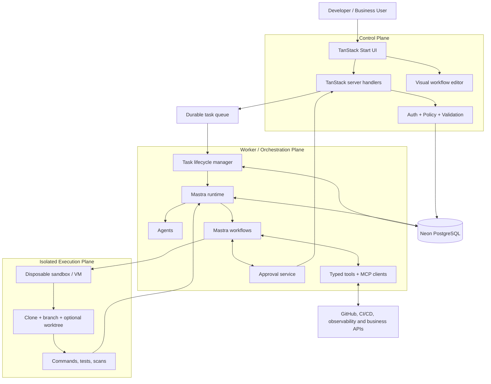

# Architecture

## 1. Purpose and design principles

The platform coordinates software-delivery tasks across repositories and existing business services. It is a control plane plus a separately operated execution plane, not a coding chatbot with unrestricted access to a server.

Principles:
- Keep the browser, control plane, orchestration worker, and untrusted code execution separate.
- Use Mastra for agent/tool/workflow composition; use deterministic application code for authorization and policy.
- Keep provider-specific model behavior behind adapters/configuration.
- Store workflow definitions as versioned, validated JSON, independent of Mastra implementation details.
- Use Neon PostgreSQL as the primary application database and system of record.
- Make runs observable, recoverable, bounded, and auditable.
- Require human approval for high-impact actions.
- Design for parallel task execution, but serialize operations that mutate the same Git branch or shared resource.

## 2. High-level diagram



## 3. Runtime responsibilities

### Web application
Use Bun and TanStack Start with React, TanStack Router, and TanStack Query. The browser renders project/repository setup, workflow authoring, task submission, run timelines, logs, diff summaries, approvals, and integration configuration.

TanStack server handlers/functions are the control-plane boundary. They validate requests, authenticate the caller, enforce tenant access, persist task metadata, and enqueue work. They must not run arbitrary repository code or hold open an HTTP request for the full agent execution.

### Worker
Run a separate TypeScript process. It claims jobs, applies idempotency, starts and monitors executions, invokes Mastra workflows, persists status/events, handles cancellation/timeouts, and cleans up sandboxes. Use a durable queue or a database-backed queue with atomic claiming, retries, dead-letter handling, and duplicate protection. Select the concrete queue implementation in an ADR before relying on it.

### Mastra agents and workflows
- **Agents** reason within a defined role and receive only the tools they need.
- **Workflows** define the SDLC state machine, branching, retries, persisted state, and approval boundaries.
- **Tools** are typed, validated operations. A tool is not authorized merely because an agent can call it.
- **Memory/RAG** is optional and must be introduced only for a clear retrieval use case. Keep per-tenant data boundaries and source citations; do not place secrets in memory.
- **Evaluations** cover task success, tool correctness, policy compliance, regression behavior, and cost/latency.

Begin with one coding agent and one explicit workflow. Add planner/reviewer agents only where tests show a useful improvement.

### Sandbox
Run all untrusted repository commands in a disposable cloud sandbox or VM. The sandbox receives only scoped, short-lived credentials required for its task. Enforce execution timeout, CPU/memory limits, output limits, network egress policy, and cleanup. The worker host and web server must never execute untrusted project scripts.

A Git worktree is a workspace convenience, not a security boundary. For independent parallel tasks, use separate sandboxes and branches/worktrees. Never allow concurrent writers to mutate the same checkout or branch without an explicit coordination protocol.

## 4. Suggested folder conventions

Adjust these to the generated TanStack Start scaffold, but keep ownership boundaries stable.

```text
apps/
  web/
    src/routes/                  # TanStack file-based routes
    src/components/              # UI components
    src/features/                # Product feature modules
    src/server/                  # Server-only handlers and services
  worker/
    src/                          # Queue consumer and run lifecycle
packages/
  mastra/
    src/mastra.ts                 # Mastra instance and registration
    src/agents/                   # Agent definitions and instructions
    src/tools/                    # Typed tools and tool factories
    src/workflows/                # Versioned SDLC workflows
    src/evals/                    # Evaluations and regression datasets
  workflow-schema/
    src/nodes/                    # Node schemas and definitions
    src/validate.ts               # Graph validation
    src/compiler/                 # Workflow definition -> runtime plan
  sandbox/
    src/providers/                # Sandbox provider adapters
    src/git/                      # Clone, branch, worktree operations
    src/policy/                   # Command and resource policy
  integrations/
    src/github/
    src/mcp/
    src/business/
  db/
    src/client.ts                 # Neon connection/client
    src/schema/
    src/repositories/
    migrations/
  shared/
    src/types/
    src/errors/
    src/logging/
docs/
project/
```

Keep provider credentials, database clients, MCP clients, sandbox SDKs, and Mastra runtime imports in server-only packages. Never import them from browser bundles. Add build-time checks or lint rules to prevent accidental client-side imports.

## 5. Core data model

Use Neon PostgreSQL for durable application state. At minimum, model:
- `organizations`, `users`, `memberships`
- `repositories`, `integrations`, `integration_permissions`
- `workflow_definitions`, `workflow_versions`
- `tasks`, `task_attempts`, `workflow_runs`
- `run_events`, `artifacts`, `approvals`
- `tool_invocations`, `audit_events`, `usage_records`

Every tenant-owned record must carry an organization/tenant identifier and be checked in server-side authorization. Use foreign keys, unique idempotency keys, and explicit lifecycle enums. Keep large logs/artifacts in object storage when appropriate; store metadata and references in Neon.

Use Neon connection pooling appropriately for serverless/web workloads, and ensure migrations and transaction patterns work with the chosen driver. Do not assume every adapter supports every pooling mode. Select the Mastra storage adapter only after confirming current PostgreSQL/Neon support; do not introduce another database merely to satisfy a tutorial.

## 6. Workflow definition and compilation

The visual editor stores a versioned JSON graph:
- nodes have stable IDs, typed configuration, and declared input/output schemas;
- edges define data flow and control flow;
- graph validation rejects missing nodes, cycles where unsupported, invalid types, unauthorized tools, unreachable required steps, and unsafe configuration;
- the compiler maps the supported subset to Mastra workflow steps and tool calls;
- each run pins a workflow version so later edits cannot silently change an active execution.

Never evaluate arbitrary user expressions with `eval` or compile arbitrary user-provided TypeScript in the control plane. Start with a small, explicit condition language and a finite node registry.

## 7. Integrations, MCP, and custom skills

Prefer native connectors for critical operations such as GitHub permissions, PR creation, and approvals. Use MCP for interoperable tools where it provides value. Treat MCP server metadata, descriptions, responses, and resources as untrusted data. Register servers through an admin-controlled allowlist, validate tool schemas, apply per-tool permissions, and record every invocation.

A skill is reusable instruction/procedure content; it is not itself a security boundary. A custom business action should be a typed tool with a schema, implementation, permission policy, tests, and audit logging. Do not permit arbitrary remote MCP servers or custom executable code by default.

## 8. Approval and policy flow

1. Agent proposes a tool operation.
2. Trusted policy code validates user/tenant access, action risk, arguments, scope, and credentials.
3. Low-risk allowed actions proceed and are audited.
4. Sensitive actions create a persisted approval record and pause the workflow.
5. An authorized user approves or rejects through a server handler.
6. The worker resumes from durable state and revalidates the action before execution.

Require explicit approval for merges, production deploys, destructive operations, secret changes, database migrations, and permission escalation. An approval must be bound to the exact action payload and expire or become invalid if that payload changes.

## 9. Reliability and bounded validation loop

Every task follows a finite state machine such as:
`queued -> planning -> awaiting_approval -> executing -> validating -> repairing -> review_ready -> pull_request_created -> completed`, with `failed`, `cancelled`, and `blocked` terminal states.

The validation loop:
1. Run configured formatter/linter, typecheck, unit tests, integration tests, and relevant security/dependency scans.
2. Capture structured failures and associate them with the attempt.
3. Allow a bounded repair attempt only for recoverable failures.
4. Re-run the relevant tests and then the full required validation suite.
5. Stop at the configured retry/time/cost limit and mark the task `blocked` or `failed`, with evidence and a suggested next action.
6. Require a human decision when the agent cannot safely proceed.

Never define “complete the goal definitely” as an infinite loop. Completion means all required gates pass, an authorized human approves privileged actions, or the system explicitly stops with a documented blocker.

## 10. Parallel agents and Git worktrees

Use a task coordinator and a single integration owner for each integration branch/release.

For every task:
- define ID, goal, owner, dependency list, package/file ownership, acceptance criteria, DoD, test commands, and risk;
- create a dedicated branch and worktree, preferably with a separate sandbox for untrusted execution;
- do not share a writable worktree across agents;
- communicate interface contracts before parallel implementation;
- commit small units and rebase/cherry-pick only under integration-owner direction;
- run cross-package validation after integration;
- resolve conflicting migrations, shared types, package scripts, and lockfile changes centrally.

Use `project/TASKS.md`, `project/STATUS.md`, `project/DECISIONS.md`, and `project/CHALLENGES.md` as the coordination source of truth.

## 11. Security and observability boundaries

- Never expose provider or integration secrets to the browser or model context.
- Apply least privilege and short-lived credentials; prefer a broker for scoped GitHub operations.
- Keep logs useful but redact tokens, private keys, personal data, and sensitive source excerpts.
- Defend against prompt injection from source files, issues, documentation, and tool responses.
- Set timeouts, resource limits, output limits, retry limits, and spend limits.
- Record actor, tenant, run, tool, arguments (redacted), policy decision, result, duration, and correlation IDs.
- Add cancellation and cleanup paths for every long-running execution.
- Test tenant isolation and authorization at API and repository layers.

## 12. Integration points and decisions to verify

- TanStack Start server handlers call control-plane services, not agent logic directly.
- The worker imports Mastra agents/workflows and runs them outside the web request lifecycle.
- Use the supported Mastra packages for agents, workflows, storage, observability, and MCP after verifying current versions.
- Do not assume a package named `@mastra/tanstack-start` exists or is required. Prefer framework-neutral Mastra server-side imports unless official documentation confirms a maintained integration.
- Confirm the current Mastra storage adapter supports Neon/PostgreSQL and the intended connection mode before implementation.
- Record any material choice in `project/DECISIONS.md` and update this document in the same PR when boundaries or data flows change.
