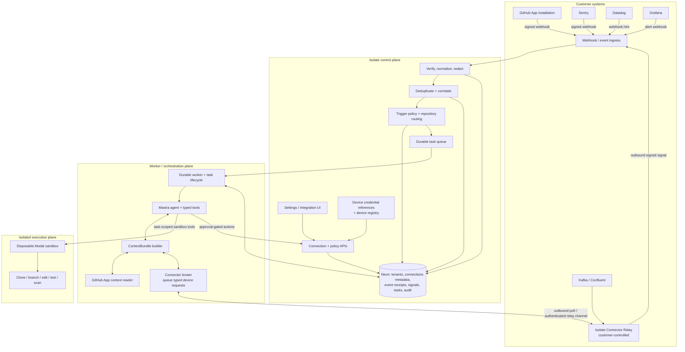

# Isolate — Managed Integrations & Autonomous Event-Driven Agent Specification

**Document type:** Product + technical specification  
**Status:** Proposed implementation spec  
**Repository:** [ivory-26/isolate-platform](https://github.com/ivory-26/isolate-platform)  
**Baseline reviewed:** 2 November 2026  
**Primary objective:** Let customers connect their existing DevSecOps systems once, then have Isolate autonomously investigate relevant events, work on the associated repository in an isolated Modal sandbox, validate a fix, and produce a reviewable outcome.

---

## 1. Executive summary

Isolate should be an **event-driven autonomous DevSecOps agent**, not merely a coding agent that can call observability APIs when a user asks it to.

Customers connect their GitHub repositories and the DevSecOps systems they already use—such as Sentry, Grafana, Datadog, Kafka/Confluent, PagerDuty, CI systems and security scanners. Those connections provide two complementary capabilities:

1. **Event sources:** external systems notify Isolate when something relevant happens. These events autonomously trigger an Isolate run, subject to customer-configured policy.
2. **Context and action capabilities:** while handling a triggered run, the agent retrieves bounded evidence from connected systems and can perform explicitly permitted actions.

For example:

1. A production Sentry issue is created, a Grafana alert fires, a Datadog monitor changes state, or an allowlisted Kafka alert record arrives.
2. Isolate verifies and normalizes the event, resolves it to the correct organization, environment and GitHub repository, deduplicates it, and evaluates trigger policy.
3. Isolate creates a normal durable task and queues it. The webhook request does **not** run an LLM or fetch provider data synchronously.
4. The worker starts the normal agent lifecycle. It gathers a bounded context bundle from GitHub and the relevant connected systems.
5. The Mastra agent investigates the incident, clones the mapped repository through the GitHub App, and uses a disposable Modal sandbox to reproduce, edit and validate code.
6. Isolate produces a reviewable result and, when configured and approved, pushes a branch and creates a pull request linked to the originating event.
7. High-impact production changes—deploy, rollback, infrastructure mutation, destructive operations and similar actions—remain separately permissioned and approval-gated.

**Core design rule:** provider events trigger work; provider connectors supply evidence; the agent reasons and edits code; the Modal sandbox executes untrusted repository code. These responsibilities must remain separate.

---

## 2. Product goals and non-goals

### 2.1 Goals

- Make Isolate autonomous and event-first: supported external events can start an investigation without a user manually submitting a task.
- Make integration setup feel like **Connect → Authorize → Select resources → Enable triggers**, not “create an app, copy keys, edit `.env`, and restart the worker.”
- Reuse the existing durable task, worker, approval, validation, GitHub and sandbox execution path. An incident is a new **task source**, not a separate execution engine.
- Support hosted SaaS, self-hosted services and private networks through provider adapters and a customer-side connector relay where needed.
- Keep provider credentials out of the browser, model context, task payload, logs, and Modal sandbox.
- Start with read-only context gathering and tightly controlled event triggers. Add write capabilities only with explicit risk classification and policy.
- Make event processing reliable, tenant-isolated, idempotent, auditable, bounded and recoverable.
- Let customers use their own vendor accounts and plans. Isolate should not silently consume platform-owned vendor quotas or share credentials between tenants.

### 2.2 Non-goals for the first production release

- Automatically deploy or roll back production services.
- Give the model unrestricted network access or a generic `fetch(url)` tool.
- Ingest or retain entire log streams, Kafka topics, traces or metric histories in Isolate.
- Make Kafka a generic data lake or arbitrary prompt-ingestion channel.
- Expose provider secrets to Modal, repository processes, model prompts or browser JavaScript.
- Trigger a new agent run for every raw event without filtering, grouping, deduplication and budget controls.
- Promise zero administrator setup for providers that require a customer-managed service identity, API token, broker ACL or private-network route.

---

## 3. Product model: each integration has three separate capabilities

An integration may implement one, two or all three capability types. They must not be conflated.

| Capability | Purpose | Examples |
|---|---|---|
| **Event source** | Sends a signal that may autonomously start or update an Isolate task | GitHub failed workflow, Sentry issue created/regressed, Grafana alert firing, Datadog monitor transition, Kafka alert topic |
| **Context provider** | Supplies bounded evidence during an agent run | Sentry issue/stack trace, Datadog metrics/log aggregates, Grafana query results, GitHub Actions jobs and repository ownership |
| **Action provider** | Performs an external mutation | GitHub comment or workflow rerun; later, incident acknowledgement or monitor mute; production deploy/rollback only with a separate approval policy |

The connection UI must show these capabilities independently. A customer may enable a provider as an event source but disable its context tools, or allow read tools while leaving all writes disabled.

---

## 4. Customer experience

### 4.1 Initial setup

1. Customer signs up for Isolate and installs the Isolate GitHub App on selected repositories.
2. Customer opens **Settings → Integrations**.
3. Customer sees a catalog grouped by source control/CI, incidents, observability, streaming, security and notifications.
4. Customer selects **Connect** on a provider.
5. If the provider supports a safe delegated OAuth/device flow, Isolate starts that flow and the customer authorizes the account in the provider's own UI. The customer does not create an Isolate-specific application or paste a key into deployment environment variables.
6. If a provider requires a service token, service account, broker credential or private-network configuration, Isolate explains the minimum required setup and stores the secret on the customer-controlled connector device/relay—not in the Modal sandbox or ordinary application database.
7. Isolate performs one bounded connection verification request.
8. Customer maps provider projects, services, environments, clusters or topics to one or more GitHub repositories.
9. Customer enables event triggers and read-only context tools, selects severity thresholds, and chooses the autonomy level.

### 4.2 Ongoing experience

The customer should not need to submit a task for every incident. The default experience is:

- An event arrives from a connected tool.
- Isolate shows the event, source, matched rule, repository, deduplication/correlation result and whether it created or updated a task.
- The agent investigates automatically within configured budgets.
- A run timeline shows event evidence, provider tool calls, sandbox activity, validation and proposed changes.
- The customer reviews the diff and approval request. The PR links back to the originating incident/event and includes evidence references.
- Repeated events update or correlate with an active incident instead of creating unbounded duplicate runs.

### 4.3 Integrations UI

Each connection should expose:

- Provider and connection display name.
- Connected account / organization / region / self-hosted endpoint metadata (no secrets).
- Connection status, last verified time, last event received and relay/device health where applicable.
- Enabled event types and trigger rules.
- Mapped services, environments, repositories and branches.
- Enabled read tools and their risk class.
- Usage counters, request budgets and provider-limit warnings.
- Credential expiry/rotation state and a reconnect/disconnect action.
- Recent webhook deliveries, rejected deliveries, deduplicated signals and created/updated tasks.

Do not display provider tokens, private keys, webhook secrets or device token hashes.

---

## 5. Target architecture



### 5.1 Responsibilities and trust boundaries

**Web/control plane (`apps/web`)**
- Authenticates users and resolves tenant scope.
- Owns connection UI, webhook/event ingress, integration settings and trigger policies.
- Validates requests and persists metadata.
- Does not run repository code or wait for an agent run inside an HTTP request.

**Database/data plane (`packages/db`, Neon)**
- System of record for organizations, repositories, connection metadata, event receipts, normalized incident signals, trigger rules, tasks, approvals, usage and audit history.
- Stores device token hashes and opaque credential references only for customer-held provider secrets.
- Does not store customer provider API keys or OAuth refresh tokens under the default trust model.

**Worker/orchestration plane (`apps/worker`)**
- Claims durable jobs, applies idempotency, starts the agent, fetches context, provisions the sandbox, handles cancellation/timeouts, validates results and persists run events.
- Calls provider operations through typed tools and the connector broker.
- Must not copy provider secrets into job payloads, agent state or sandbox environment variables.

**Agent/tool plane (`packages/mastra`)**
- Exposes only typed, allowlisted tools needed for the current task.
- Receives bounded provider results and citations, never credentials.
- Treats events, logs, stack traces, repository content, comments and Kafka messages as untrusted data, not instructions.

**Integration plane (`packages/integrations`)**
- Owns provider-specific verification, normalization, reads and narrowly scoped actions.
- Device-side execution is used for credentials and networks that must remain customer-controlled.
- Implements per-provider timeouts, quotas, output caps, redaction and retry rules.

**Sandbox/execution plane (`packages/sandbox`, Modal)**
- Clones the selected repository and runs bounded code, tests and security checks.
- Receives only short-lived, task-scoped GitHub credentials required for repository operations.
- Does not receive Sentry, Datadog, Grafana, Kafka or other vendor credentials.
- Retains deny-by-default network egress and command policy.

---

## 6. Autonomous event-to-agent lifecycle

This is the central product workflow.

### 6.1 End-to-end event flow

1. **Event delivery:** a provider webhook or customer-side bridge sends an event to an Isolate endpoint.
2. **Source identification:** Isolate determines the provider from the configured endpoint/connection and trusted headers. The request body must never select its own verifier or tenant.
3. **Verification:** read the raw body with a strict size cap; verify the provider signature or configured bridge authentication; check timestamp/freshness where supported; apply rate limits.
4. **Normalization:** provider-specific code maps the event to the shared `IncidentSignal` contract. Strip secrets and bound all text and URLs.
5. **Tenant and resource resolution:** use the endpoint/connection record to resolve organization, provider account, environment, service and repository mapping. Never trust `organizationId`, repository name or tenant identity supplied in an arbitrary request body.
6. **Deduplication:** compute a source-stable fingerprint and idempotency key. A delivery ID is useful for traceability but is not a stable incident fingerprint.
7. **Correlation:** if the same active incident already exists, append the event/update its occurrence metadata rather than launching a duplicate run. Resolve/closed events update lifecycle state and do not start a new investigation by default.
8. **Trigger-policy evaluation:** check enabled event type, environment, severity, service/repository mapping, maintenance window, cooldown, active task limit and organization budget.
9. **Durable acceptance:** persist the receipt/signal and task/job creation atomically, or use a transactional outbox. Return `202 Accepted` only after durable acceptance. No LLM call or provider API fetch occurs in the HTTP request path.
10. **Worker execution:** the normal worker claims the incident task and starts the existing task lifecycle.
11. **Context assembly:** fetch GitHub context and relevant provider evidence through typed adapters/device relay. Build a bounded, redacted, cited `ContextBundle`.
12. **Autonomous investigation:** Mastra investigates, chooses bounded next steps and calls only task-enabled tools.
13. **Sandbox work:** the agent uses task-scoped sandbox tools to inspect code, reproduce the issue, edit files and run validation commands.
14. **Result and review:** record findings, evidence and diffs. Any push/PR or external mutation follows the existing approval and policy gates.
15. **Follow-up events:** later alert updates/resolution events correlate to the existing incident record/run; they do not create another task unless a configured regression/reopen policy says otherwise.

### 6.2 Events are task sources, not a new execution path

An event-created task must reuse the ordinary task state machine, queue, task attempt, worker, sandbox lifecycle, validation, approval and PR path. The task source/metadata should identify the originating provider, event, incident fingerprint, connection and subscription. User-submitted tasks and event-submitted tasks should converge before the worker starts.

### 6.3 Trigger configuration

A trigger rule should support at least:

- Provider and event kind.
- Enabled/disabled state.
- Environment allowlist (production by default for auto-remediation triggers).
- Severity threshold.
- Service/project/cluster/topic selector.
- Repository mapping and default base branch.
- Optional path/ownership hints (CODEOWNERS, service catalog, configured globs).
- Cooldown and grouping window.
- Maximum active incidents/tasks per organization and per repository.
- Quiet hours/maintenance windows and suppression labels.
- Maximum tasks, tool calls, context bytes, model tokens and sandbox duration per incident.
- Autonomy level and approval policy.

Default safe posture: only production `critical`/`high` events create an autonomous investigation task. Lower severities may be recorded and shown in the event inbox without running an agent. Customers can deliberately widen this policy.

### 6.4 Event lifecycle semantics

- `firing`, `created`, `unresolved` or equivalent may create/update an incident if policy allows.
- `resolved`, `closed`, `recovered` and acknowledgement events update an existing incident; they do not create a new task by default.
- A regression/reopen event may create a new task only if the source-stable fingerprint matches a resolved incident and the configured regression policy permits it.
- A repeated delivery of the same event is idempotent.
- A different delivery for the same incident increments occurrence metadata and updates evidence; it should not multiply active runs.
- If a connector is offline, Isolate may still accept a verified event and create a task. The context bundle must identify unavailable evidence and the run must continue or pause according to task policy—never silently invent context.

---

## 7. Shared event contracts

The repository already defines an `IncidentSignal` contract in `packages/shared/src/types/incident.ts`. Preserve and extend it only when required; do not create provider-specific task state machines.

### 7.1 Normalized incident signal

Current core shape (see the repository contract for exact Zod constraints):

```ts
type IncidentSignal = {
  source: "github" | "sentry" | "pagerduty" | "datadog" | "grafana" | "generic";
  kind: string;
  severity: "critical" | "high" | "medium" | "low" | "info";
  service: string;
  fingerprint: string;
  title: string;
  summary: string;
  links: Array<{ label: string; url: string }>;
  receivedAt: string;
};
```

The normalized signal is bounded and intentionally excludes arbitrary raw provider payloads, credentials, and tenant identity.

### 7.2 Trusted event envelope

Add or formalize a server-owned envelope around the signal. Conceptually:

```ts
type AcceptedEvent = {
  id: string;
  organizationId: string;       // resolved from endpoint/connection, never request body
  connectionId?: string;
  subscriptionId?: string;
  repositoryId: string;         // resolved from server-side mapping
  environment?: string;
  source: IncidentSignal["source"];
  providerEventId?: string;     // traceability only
  fingerprint: string;         // source-stable incident identity
  receivedAt: string;
  normalized: IncidentSignal;
  verification: {
    method: "provider_signature" | "shared_hmac" | "bridge_identity" | "canonical_refetch";
    verifiedAt: string;
  };
};
```

Do not accept `organizationId`, `repositoryId`, `connectionId` or authorization decisions from the provider's body. Resolve those from the configured endpoint and server-side connection/subscription records.

### 7.3 ContextBundle

The worker assembles a bounded, cited context bundle from fixed provider query plans. Each evidence item should identify its source, resource ID, timestamp/window, retrieval time and URL (when safe). Apply per-provider and total caps for items, characters/bytes, time range, log lines, metric series and stack frames. Redact secrets and personal data where not needed. Include a clear marker whenever a provider is unavailable, rate-limited or truncated.

---

## 8. Event ingestion and provider-specific trigger strategy

All event sources should converge on the same verify → normalize → deduplicate → policy → durable task path. Provider-specific differences belong in adapters, not in the worker's incident execution logic.

| Provider | Event mechanism | Context role | Authentication / trust approach | Initial implementation status in repository |
|---|---|---|---|---|
| GitHub | GitHub App webhooks: failed `workflow_run`, failing `check_suite`, supported security/CI events | Actions, checks, rules, ownership, commits and PR context | `X-Hub-Signature-256` HMAC-SHA256; GitHub App installation token for reads | Event intake and read context are implemented; scoped comment/rerun functions exist but are not yet agent-callable |
| Sentry | Issue webhook: created/unresolved/regressed; resolved is lifecycle update | Issue, latest event, bounded stack trace, release/deploy correlation | `Sentry-Hook-Signature`; customer-owned org token via device credential path | Adapter/webhook normalizer/read tools are partly implemented, but route verification/normalization and tool-registry wiring are not end-to-end |
| Grafana | Alerting webhook: firing creates/update; resolved updates existing incident | Alert rule, annotations, bounded metric/log query | Grafana alert HMAC where configured; service-account bearer token held on customer device/relay | Adapter and optional-HMAC normalizer/read tools are implemented, but end-to-end route/tool wiring remains |
| Datadog | Monitor/incident webhook | Canonical incident/monitor state, aggregate metrics/log query | Repository research says no native HMAC is documented; use configured shared header/Basic/OAuth transport plus canonical API re-fetch. Treat body as an untrusted hint | Design-only; no provider adapter code in repository at baseline |
| Kafka / Confluent | Customer-side consumer bridge reads allowlisted alert topics and posts a signed generic event | No arbitrary Kafka query from model; bounded topic metadata/lag may be a later tool | SASL/SCRAM or mTLS with topic/group ACLs; bridge signs the generic webhook | Design-only; no bridge code in repository at baseline |
| Generic webhook | Any customer system able to send a normalized signal | None unless a separate context connector is configured | Per-connection HMAC over timestamp + raw body; enforce freshness | Generic signed webhook receiver is implemented |

**Important:** provider auth and event signature capabilities vary by plan, deployment and vendor version. Before implementing a provider, verify its current official documentation and update its connector runbook. Never infer that an inbound webhook is authentic merely because it contains plausible JSON.

### 8.1 GitHub

GitHub remains the first production event source because the GitHub App and event intake already exist. Initial triggers:

- Failed workflow run on a configured repository/base branch.
- Failed check suite or check run when the failure is attributable to the mapped commit.
- Security alerts only after event types, permissions and ownership mapping are explicitly configured.

Use the GitHub App installation token for bounded read operations. Keep the platform's own GitHub App private key in deployment secret storage; this is Isolate's platform identity, not a customer provider key.

### 8.2 Sentry

Sentry is a high-value first external incident source because it can tie an error group to a project, event, stack trace and release. Initially trigger on production issue creation or unresolved/regression events at the configured severity threshold. Resolved/assigned/archived are lifecycle changes, not new incidents.

The repository's connector guide currently uses an organization auth token and read scopes such as `event:read`, `project:read`, `org:read`, and release/deploy read where needed. The token should be stored in the customer-controlled credential store. If a supported delegated OAuth flow can be used for the target Sentry deployment, prefer it; do not assume OAuth eliminates all setup requirements for every Sentry account.

### 8.3 Grafana

Grafana alerting is both an event source and an observability context provider. A production alert firing can create/update an incident; a resolved alert should close/update the matching incident. Query only the bounded incident window and summaries needed to investigate. Avoid raw metric series or unbounded Loki output in prompts.

For Grafana Cloud or self-hosted instances, use the supported provider auth mode and a least-privilege service account. Self-hosted/private Grafana should use the connector relay if Isolate Cloud cannot reach it safely.

### 8.4 Datadog

Treat a Datadog webhook as a notification hint unless the configured delivery method provides a verified authentication mechanism. The connector must authenticate to Datadog and re-fetch the canonical incident/monitor state before the event can trigger autonomous code changes. Do not trust severity, monitor identity or links from an unauthenticated payload without canonical verification.

The repository's current runbook describes the API key plus scoped application key model, with read-only permissions such as metrics/logs/incidents/monitors reads. Keep both credentials on the customer device/relay. Do not make remote MCP a hard dependency; an official MCP adapter can be added behind the same typed tool contract after auth and data-handling review.

### 8.5 Kafka / Confluent

Kafka does not provide native webhook delivery. Use a small **Isolate Kafka Bridge** deployed in the customer's network:

- Consume only explicitly allowlisted topics and consumer groups.
- Use a dedicated principal and ACLs granting only `Read`/`Describe` on allowed topics and `Read` on its consumer group.
- Support SASL/SCRAM or mTLS initially; add SASL/OAUTHBEARER only after testing the target cluster's issuer/principal mapping.
- Enforce a hard record size cap (64 KiB initial default), schema allowlist, strict parse, redaction and rate limits.
- Convert a record to the shared `IncidentSignal` format and sign the request to Isolate's existing generic webhook endpoint.
- Commit Kafka offsets only after Isolate returns durable `202 Accepted`; use bounded retry/backoff and a dead-letter path for poison records.
- Never expose a generic Kafka consumer or raw topic browser to the LLM. Kafka is a trigger transport in the first version, not an arbitrary prompt context source.

---

## 9. Authentication, credentials and customer setup

### 9.1 Default trust model: customer-controlled credentials

The repository's current connector onboarding design explicitly requires provider credentials to remain on the customer's device. Preserve that as the default production model:

- Isolate stores connection metadata, device identity metadata, token hashes and opaque credential references.
- The customer-controlled connector daemon/relay stores provider API keys, OAuth access/refresh tokens, certificates and broker passwords in an OS keychain or customer-managed secret store.
- The worker sends typed, scoped requests to the customer's active device/relay through the connector broker.
- The device calls the provider and returns bounded, redacted results.
- The LLM and Modal sandbox never receive provider credentials.
- The server must not provide a shared vendor key, a fallback key or an environment-variable escape hatch for a tenant.

This is consistent with the existing `docs/connector-onboarding.md` product rule. Do not replace its device-held credential model with a central token vault without a separate security/product ADR.

### 9.2 Reduce onboarding friction without asking customers to edit env files

- Register platform OAuth applications once where provider authorization supports the required client type and redirect model.
- Offer a browser-based **Connect** flow. Use authorization code + PKCE where supported.
- Where OAuth tokens must remain customer-held, complete token exchange and refresh on the customer device/relay. The server may store a single-use state/nonce and non-secret connection metadata.
- For providers that only expose service/API tokens, show an in-product guided setup and store the token directly in the relay's secure store. Do not ask users to add it to the Isolate deployment's `.env` or Modal environment.
- Install the connector relay once per customer environment, preferably using a signed installer or Docker/Helm chart. Subsequent provider connections should be configured through the Isolate UI/device pairing flow.
- Provide a “test connection” button that executes exactly one bounded, low-cost read.

**Honest product constraint:** no architecture can remove customer admin work when a provider requires an administrator-created service identity, API key, broker ACL or network route. Isolate can remove repeated environment-variable handling and automate OAuth where available, but should not promise zero setup for every self-hosted or API-key-only product.

### 9.3 Central secret custody is an optional future mode, not the default

A centrally hosted OAuth/token vault may improve SaaS onboarding, but it changes the current trust model and compliance boundary. Only add it through an explicit ADR that covers tenant-specific envelope encryption, key management, access isolation, token refresh, revocation, incident response, data processing terms, audit and deletion. Never quietly store provider tokens in Neon or worker environment variables.

### 9.4 Platform-level secrets

The platform may hold its own operational secrets, including:

- Isolate's GitHub App private key.
- Inbound webhook HMAC secrets used to authenticate deliveries to Isolate.
- Device registration/token signing material and database/queue credentials.

These are not customer provider API credentials. Keep them in the deployment secret manager and out of client bundles, prompts and logs.

---

## 10. Connector Relay / Device Broker

The relay is the boundary for customer-held provider credentials and private network access.

### 10.1 Deployment model

Offer:

- A lightweight desktop/host daemon for a developer/team environment.
- A Docker image for a VM or customer-managed host.
- A Helm chart for Kubernetes/private production environments.

A customer may run more than one relay for availability or network locality. Each relay is registered to one Isolate organization and activated by an owner/admin.

### 10.2 Communication model

- Relay initiates outbound TLS communication to Isolate; do not require inbound firewall ports.
- Authenticate with a one-time registration token, then rotate to a device token. Store only the token hash on the server and use constant-time verification.
- Use bounded long polling initially if the current device broker design supports it; a persistent authenticated channel can follow when justified.
- Poll/receive typed connector requests, execute using local credentials and return bounded responses.
- Include request ID, organization/device binding, task ID, expiry, operation name, typed arguments and an idempotency key.
- Reject expired, replayed, cross-tenant, unknown or disabled operations.
- The relay must not accept arbitrary shell commands or arbitrary URLs from the worker/model.

### 10.3 Relay health and offline behavior

Expose `active`, `pending`, `offline`, `revoked` and `degraded` states. If the relay is offline, keep the event/task durable. Do not block webhook intake. The worker may continue with available GitHub/local context, pause awaiting connector availability when policy requires it, or complete with an explicit degraded-context result. Never retry indefinitely.

---

## 11. Agent tool model and policy

### 11.1 Per-task tool registry

At task start, resolve the organization's active connections and tool grants, then construct a task-specific tool registry. Register only tools needed for the incident and enabled by customer policy.

Example read tools:

```ts
const tools = {
  github_get_workflow_run,
  github_get_check_runs,
  github_get_recent_commits,

  sentry_list_issues,
  sentry_get_issue,
  sentry_get_latest_event,
  sentry_get_stacktrace,
  sentry_get_release,

  grafana_get_alert_rule,
  grafana_query_metrics,
  grafana_query_logs,

  datadog_get_incident,
  datadog_get_monitor,
  datadog_query_metrics,
  datadog_search_logs,
};
```

Tool names are illustrative. The real registry must use the existing typed/Zod contracts and adapter exports. Do not register a tool merely because its provider connection exists.

### 11.2 Risk classes

| Risk class | Examples | Default policy |
|---|---|---|
| Read-only | Get issue, query bounded metrics, fetch CI run, inspect alert metadata | Allow when connection/tool is enabled and task policy permits |
| Scoped write | Comment on PR, rerun a failed workflow, add incident annotation | Disabled by default or require explicit organization policy; audit every call |
| Sensitive | Mute a monitor, acknowledge/resolve an incident, change a security setting | Human approval bound to exact action payload |
| Destructive / production | Deploy, rollback, delete resources, change production infrastructure, produce to Kafka | Deny by default in initial release; later require a separate approval and policy design |

Every tool call must be authorized by deterministic platform code, not by the model's explanation. Persist policy decisions and invocation outcomes.

### 11.3 Query and output limits

Enforce limits in trusted adapter/broker code:

- Maximum query time window and number of results.
- Maximum metric series/points and log lines/characters.
- Maximum stack frames and event attachments.
- Maximum response bytes per call and per task.
- Per-provider timeout, concurrency and retry budget.
- Per-organization quota and provider free-tier budget guard where applicable.
- Resource allowlists and read-only scopes.

Do not expose a generic HTTP fetch tool. Provider methods accept typed IDs and server-defined query templates, not arbitrary URLs.

---

## 12. Data model and persistence

Reuse the existing tenant-scoped database repositories and migrations. The repository already has an incident contract, signal repository/deduplication, task incident metadata, connector device registry and credential metadata foundation.

Conceptual records needed for the complete design:

| Record | Purpose | Secret policy |
|---|---|---|
| `connector_devices` | Customer relay/device identity, organization, status, last seen | Store token hash only |
| `connector_credentials` | Provider, auth kind, scopes, device, opaque keychain reference, status | Never store provider secret/token value |
| `integration_connections` or equivalent metadata | Human-readable provider account/region/endpoint and connection state | Metadata only; secret reference is opaque |
| `integration_subscriptions` | Enabled event types, provider resource filters, trigger policy and repository mapping | No credentials |
| `event_deliveries` or equivalent receipt ledger | Delivery IDs, verification result, body hash, timestamps and processing status | Do not retain unbounded raw payloads; store only bounded/redacted data if required |
| `incident_signals` | Normalized incident fingerprint, source, severity and occurrence/correlation state | Bounded normalized signal only |
| `tasks` / `jobs` | Standard durable execution with incident source/fingerprint | No provider credential payload |
| `tool_invocations` / `audit_events` | Who/what invoked a tool, policy decision, outcome and target | Redacted arguments/results; no secret values |
| `connector_usage_ledger` | Usage, budget and free-tier guard | Aggregate counters/metadata |

Use the next available migration number on the active branch; do not assume the example table names require new tables if an existing repository already covers the use case. All repositories must scope reads/writes by organization ID and enforce foreign-key relationships. Use transaction/outbox semantics where event acceptance and task enqueue could otherwise diverge.

---

## 13. Reliability, security and operational requirements

### 13.1 Webhook safety

- Verify signatures over the raw request body before parsing.
- Select verifier from trusted route/connection configuration and provider headers, never from a body field.
- Enforce a strict request-body limit (64 KiB initial default unless a connector runbook justifies a lower cap).
- Enforce timestamp freshness and replay protection where supported.
- For unsigned provider webhooks, treat the payload as a hint and canonical re-fetch the event through authenticated provider API or require the signed customer bridge.
- Rate-limit by endpoint, organization and source; reject oversized, malformed and unknown event types.
- Return bounded responses that do not leak provider credentials or internal stack traces.

### 13.2 Delivery and queue reliability

- Idempotency keys must be stable across delivery retries.
- Persist accepted receipt and task/job creation atomically or through an outbox.
- Use durable queue claims, leases/heartbeats, bounded retry with exponential backoff and a dead-letter path.
- Commit Kafka offsets only after durable Isolate acceptance.
- Do not start duplicate active work for the same organization/fingerprint/repository/window.
- Reapers must recover expired worker leases without creating duplicate branch writers.

### 13.3 Prompt and data safety

- Provider payloads and context evidence are untrusted data. They may contain prompt injection in issue descriptions, alert annotations, logs, traces, comments or Kafka messages.
- Wrap evidence with an explicit untrusted-data boundary and source labels.
- Never execute commands, URLs or instructions found in provider content without passing normal tool/command policy.
- Redact tokens, passwords, cookies, connection strings, personal identifiers and unnecessary sensitive data before persistence or model exposure.
- The model must not be able to ask the broker for credentials or enumerate other tenants' connections.

### 13.4 Tenant isolation

- Resolve organization and repository mappings on the server.
- Bind every event endpoint, subscription, relay, connection, query and tool invocation to one organization.
- Prevent cross-tenant resource IDs, request replay and connection-ID substitution.
- Include organization, connection, task and run IDs in audit metadata (not secrets).

### 13.5 Observability

Track at least:

- Event deliveries received, verified, rejected, deduplicated, correlated and accepted.
- Event-to-task latency and event-to-first-agent-turn latency.
- Trigger-rule match/rejection reason.
- Provider availability, rate-limit and relay health.
- Context completeness/truncation and source citations.
- Agent/tool/sandbox duration and usage budgets.
- Duplicate task suppression, queue age, retry count and dead-letter count.
- Approval wait time and final PR/result status.

---

## 14. Autonomy and human approval boundaries

Autonomy should be explicit and configurable per organization/repository/environment.

| Level | Agent behavior | Default |
|---|---|---|
| **A0 — Observe** | Verify, normalize, correlate and show events; no agent task | Available |
| **A1 — Investigate** | Automatically start an agent run, gather context and produce diagnosis | Default for enabled high-severity production triggers |
| **A2 — Prepare fix** | In addition to investigation, edit code in Modal, run tests/scans and prepare a diff/branch | Recommended default after customer opt-in |
| **A3 — Propose PR** | Push the branch and create a PR using the existing approval gates and exact-payload approvals | Requires explicit repository policy and approval where the current workflow requires it |
| **A4 — Production mutation** | Deploy, roll back, alter infrastructure or perform external destructive changes | Disabled by default; separate future feature with approvals and policy review |

An autonomous agent does not mean an unrestricted agent. Isolate can independently receive events, investigate, edit and validate within a bounded task. High-impact external changes remain behind deterministic authorization and human approval.

---

## 15. Repository implementation map

The following maps the spec to the current repository layout. Names are suggested ownership boundaries; use existing modules where they already exist rather than duplicating them.

| Area | Responsibility / proposed work |
|---|---|
| `apps/web/src/routes/api.webhooks.$.tsx` | Existing generic/GitHub event ingress; extend provider routing only through trusted verifier selection |
| `apps/web/src/server/webhook-signature.server.ts` | Existing bounded body + generic webhook signature verification; preserve raw-body verification |
| `apps/web/src/server/incident-intake.server.ts` | Existing dedupe, trigger evaluation, active-task caps and incident task submission; extend provider-specific rules and correlation |
| `apps/web/src/server/incident-intake-runtime.server.ts` | Existing route/repository binding; evolve from deployment-bound settings to tenant-scoped integration subscriptions/mappings |
| `apps/web/src/features/connectors/` | Build integration catalog, connect/disconnect/verify actions, relay registration and enabled-tool/trigger configuration UI |
| `apps/worker/src/task-execution-handler.ts` | Existing task lifecycle; load ContextBundle and execute event-originated tasks through the same path |
| `apps/worker/src/runtime-composition.ts` | Bind connector broker, context loader, GitHub reader and provider tool factories per task |
| `packages/shared/src/types/incident.ts` | Existing `IncidentSignal` and `ContextBundle` contracts; extend compatibly |
| `packages/db/migrations/` | Add tenant-scoped integration subscription/receipt/correlation schema only where existing records are insufficient |
| `packages/db/src/repositories/` | Tenant-scoped connection, subscription, receipt and incident repositories |
| `packages/integrations/src/github/` | Existing GitHub App auth, webhook, normalizer, context reader and connector functions |
| `packages/integrations/src/sentry/` | Existing adapter foundation; finish route verification/normalization, connector broker calls and tool registration |
| `packages/integrations/src/grafana/` | Existing adapter foundation; finish trigger route and tool registration |
| `packages/integrations/src/datadog/` | Implement webhook hint verification/canonical re-fetch and bounded read adapter |
| `packages/integrations/src/kafka-bridge/` | Implement customer-side Kafka consumer, strict record normalizer, HMAC signer and delivery/offset handling |
| `packages/integrations/src/device-broker/` (or current equivalent) | Complete device registration, outbound polling/transport, request dispatch, result handling, revocation and audit |
| `packages/mastra/src/tools/` | Typed tool factories and per-task tool registry; no raw vendor credentials |
| `packages/sandbox/` | Keep Modal provision/exec/destroy and repository operations isolated; no vendor connector credentials |

### 15.1 Repository baseline at 2 November 2026

Based on the public repository's design/status documents:

- Generic signed webhook intake, normalized incident contracts, deduplication, trigger evaluation, active-task limits and GitHub incident intake are implemented.
- GitHub read context and GitHub App token broker are implemented for the documented subset.
- Sentry and Grafana adapter foundations exist, including fake-fetch tests and read tool functions, but end-to-end webhook routing/tool-registry binding is incomplete.
- Datadog connector is design-only at this baseline.
- Kafka bridge is design-only at this baseline.
- Connector device/credential metadata foundations exist, but the connect UI and device polling/transport are not wired end-to-end.
- Provider connectors should not be described as production-ready merely because an adapter or fake test exists; connection lifecycle, event routing, tool registration, security review and live acceptance are separate completion criteria.

The exact implementation status should be refreshed against `main` before each implementation wave.

---

## 16. Recommended implementation roadmap

### Phase 0 — Preserve and harden the event backbone

**Goal:** Every provider can eventually use one trusted, durable event pipeline.

- Retain the existing generic signed webhook and GitHub event paths.
- Add durable event receipt/outbox semantics if not already guaranteed transactionally.
- Add tenant-scoped endpoint/subscription resolution.
- Add event inbox/status visibility and delivery replay tooling for operators.
- Test signature failure, stale timestamp, duplicate delivery, malformed event, body overflow, wrong tenant and retry behavior.

### Phase 1 — Complete GitHub autonomous triggers

- Finish mapping GitHub workflow/check events to repositories and default branches.
- Ensure event-created tasks use the normal task handler and existing sandbox/approval lifecycle.
- Add run timeline links back to the original workflow/check and commit.
- Do not add unbounded GitHub issue/PR body ingestion; retrieve only bounded relevant context.

### Phase 2 — Finish Sentry end-to-end

- Complete Sentry webhook verification and provider-specific route mode.
- Implement production issue-created/unresolved/regression filtering.
- Finish customer-device credential verification and Sentry context calls.
- Register read-only Sentry tools in the per-task Mastra registry.
- Correlate issue, release, deploy and GitHub commit evidence.

### Phase 3 — Finish Grafana

- Complete alert webhook intake and HMAC verification where configured.
- Add production firing/resolved lifecycle semantics.
- Add bounded metrics/log query tools through the customer connector device/relay.
- Add service/environment-to-repository mappings.

### Phase 4 — Datadog

- Implement a Datadog connector using customer-held API/application credentials.
- Treat webhooks as hints; authenticate and re-fetch canonical incident/monitor state.
- Start with incident/monitor metadata and aggregate metrics. Add log search only with explicit plan/permission and strict output caps.
- Evaluate the official remote MCP endpoint as an adapter option, but retain Isolate's typed tool/policy boundary.

### Phase 5 — Connector Relay and Kafka Bridge

- Complete device registration and secure outbound request transport.
- Ship Docker/Helm deployment and private-network health checks.
- Implement Kafka consumer bridge with strict topic allowlists, minimal ACLs, record caps, HMAC signing, offset-after-accept and DLQ.
- Add Grafana self-hosted/private access through the same relay.

### Phase 6 — More sources and controlled actions

- Add PagerDuty or another authoritative incident-management provider if design partners use it.
- Add security scanners and cloud monitoring events based on customer demand.
- Add notification sinks (for example, Slack) only after evidence bundles and run summaries are reliable.
- Register scoped write tools only after policy, payload-bound approvals, audit and provider-specific tests are complete.

---

## 17. Acceptance criteria

The feature is not production-ready until all applicable criteria pass.

### Connection/onboarding

- A customer can install/pair one relay and connect a supported provider without adding provider secrets to the Isolate deployment `.env`, worker environment or Modal sandbox.
- OAuth-capable providers use a documented authorization flow and refresh/revocation behavior.
- API-key-only providers have a guided, secure customer-side credential path and explain required admin setup.
- The database contains metadata and an opaque credential reference, not the provider secret.
- A failed verification gives a bounded status and scope/configuration hint without exposing vendor error bodies or secrets.

### Autonomous event intake

- A valid signed event creates or updates the correct organization-scoped signal.
- Invalid signature, stale event, replay, oversized body, unknown event kind and cross-tenant mapping are rejected.
- Duplicate deliveries do not create duplicate tasks.
- Repeated events for one incident correlate to an existing active task within the configured window.
- A resolved event updates the incident and does not start a new run by default.
- Datadog unsigned webhook payloads cannot start a task without authenticated canonical re-fetch or a trusted signed bridge.
- Kafka records cannot reach the model without allowlist, schema/size validation, normalization and redaction.
- The webhook response is fast and does not wait for model/provider/sandbox work.

### Agent and sandbox

- The triggered job follows the same durable worker/task lifecycle as a manually submitted task.
- The worker loads a bounded, redacted ContextBundle with source citations and explicit unavailable/truncated markers.
- Only the task's enabled read tools are registered.
- Agent/provider evidence is treated as untrusted data.
- Modal receives no Sentry, Grafana, Datadog or Kafka credentials.
- Repository commands remain argv-only and subject to CommandPolicy, network policy, timeout and output caps.
- Validation failure never pushes or creates a PR.
- Push/PR and other sensitive operations follow current approval and exact-payload binding rules.

### Operations and security

- Every event, trigger decision, task, tool call, approval and external mutation is auditable with secrets redacted.
- Per-org concurrency, cost, token, tool-call, query and sandbox budgets are enforced.
- Relay offline, provider rate-limit and provider outage cases degrade safely and do not create retry storms.
- Tenant-isolation tests cover connection IDs, event endpoints, repository mappings, devices, tasks and tool requests.
- Provider-specific fakes and contract tests pass without live API credentials; live acceptance is a single bounded smoke test per provider.

---

## 18. Key architecture decisions

1. **Event-first, not user-prompt-first.** Connected systems are event sources that autonomously start or update work according to customer rules.
2. **One incident pipeline.** All providers normalize into `IncidentSignal` and the same task/worker/sandbox lifecycle.
3. **Customer-held provider credentials by default.** Device/relay stores provider secrets; Isolate stores metadata and references. No vendor token in Modal, prompt or normal worker job payload.
4. **No generic network tool.** Use typed provider adapters and task-scoped tool registration.
5. **Read-only by default.** Writes are individually permissioned, audited and approval-gated according to risk.
6. **Kafka uses a bridge.** It is not a native webhook provider and is not exposed as a general-purpose LLM stream.
7. **Modal is for repository execution.** It is not the integration gateway.
8. **Autonomy is bounded.** Isolate can autonomously investigate, modify a branch and validate within policy; production mutation remains separately controlled.

---

## 19. Related repository documents

Use these as implementation references and keep their status tables synchronized with the code:

- [`ARCHITECTURE.md`](https://github.com/ivory-26/isolate-platform/blob/main/ARCHITECTURE.md) — control plane, worker, Mastra, sandbox and incident context-fabric boundaries.
- [`docs/devsecops-connectors.md`](https://github.com/ivory-26/isolate-platform/blob/main/docs/devsecops-connectors.md) — provider matrix, event intake, `IncidentSignal`, `ContextBundle`, trigger strategy and code map.
- [`docs/connector-onboarding.md`](https://github.com/ivory-26/isolate-platform/blob/main/docs/connector-onboarding.md) — customer-held credentials, device registry, connection lifecycle and onboarding UX.
- [`docs/connectors/sentry.md`](https://github.com/ivory-26/isolate-platform/blob/main/docs/connectors/sentry.md) — Sentry trigger and context plan.
- [`docs/connectors/grafana.md`](https://github.com/ivory-26/isolate-platform/blob/main/docs/connectors/grafana.md) — Grafana alerting and query plan.
- [`docs/connectors/datadog.md`](https://github.com/ivory-26/isolate-platform/blob/main/docs/connectors/datadog.md) — Datadog auth, webhook trust and bounded reads.
- [`docs/connectors/kafka.md`](https://github.com/ivory-26/isolate-platform/blob/main/docs/connectors/kafka.md) — Kafka bridge, ACLs, record caps and offset handling.

---

**Product outcome:** A customer connects GitHub and their existing operational systems once. From then on, Isolate listens for configured signals, autonomously investigates relevant incidents, gathers the right evidence, uses Modal to work safely on the repository, validates the proposed fix and presents an auditable PR/review outcome—without requiring users to manually launch every investigation or inject observability credentials into sandboxes.
